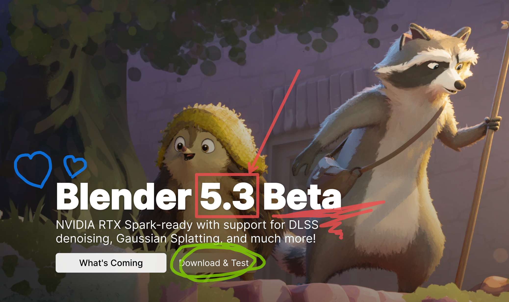
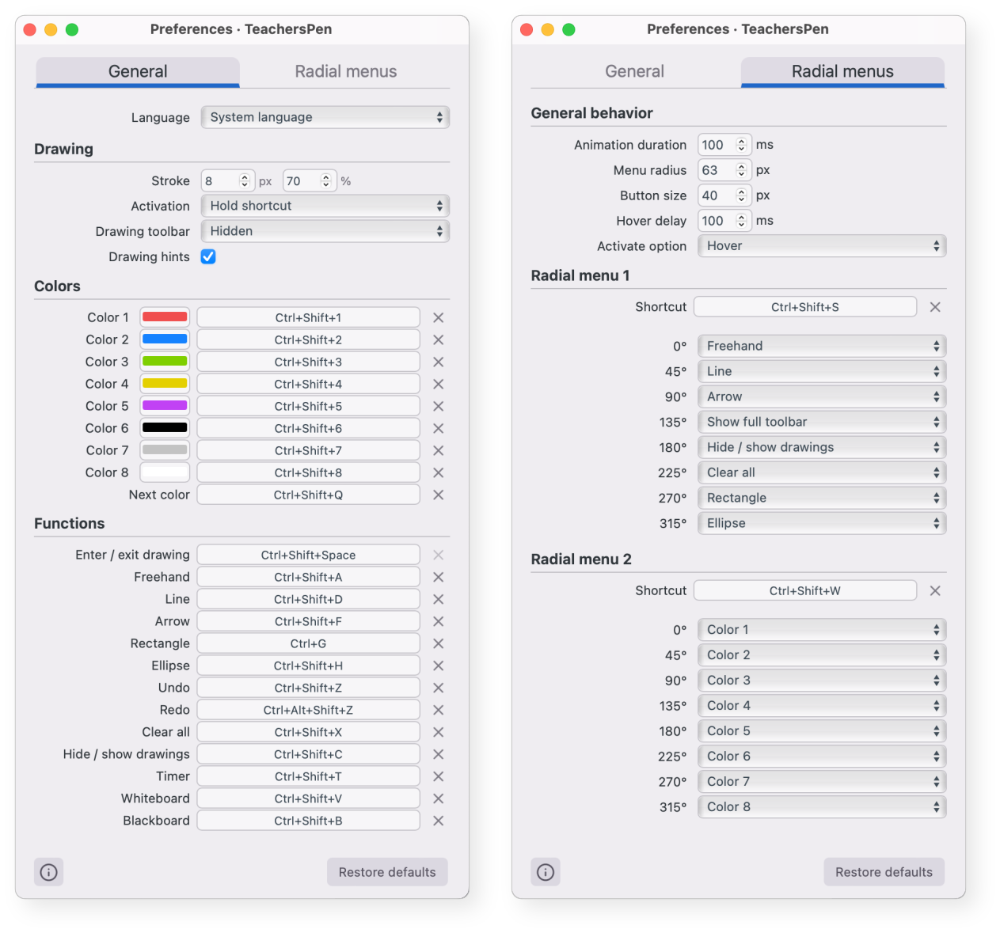

# TeachersPen

TeachersPen lets you draw and write over your desktop while the applications underneath keep running. Highlight part of a presentation, point out details on a website, or explain something over a video without taking a screenshot first.

Designed for teachers and educators, it is also useful for demonstrations, tutorials, and screen sharing.



## What you can do

- **Draw on screen:** use the freehand pencil, lines, arrows, rectangles, and circles.
- **Make your annotations stand out:** choose colors, stroke width, and transparency.
- **Use a whiteboard or blackboard:** switch to a plain background for explanations and exercises.
- **Keep control of your desktop:** leave drawing mode to interact with other apps while your annotations remain visible.
- **Manage your drawings:** undo, redo, hide, show, or clear annotations.
- **Time an activity or a break:** use a floating timer with countdown and count-up modes, plus a customizable caption.

Annotations stay in place on the screen; they do not follow the content when you scroll or move a window. Drawings are temporary and are not saved when you close the app.

## A toolbar that fits your workspace


Move the toolbar wherever it suits you and choose a horizontal or vertical layout. Keep it visible, collapse it to a small floating button, or hide it and use keyboard shortcuts. You can reopen it from the menu-bar or system-tray icon.

To get started, select a drawing tool and draw on the screen. Press **Ctrl+Shift+Space** to switch between drawing and interacting with your desktop. On macOS, use the **Control** key for this shortcut.

## Preferences



Customize colors, drawing settings, keyboard shortcuts, and toolbar behavior. Choose whether a shortcut toggles drawing mode or activates it only while you hold the keys. Your preferences are saved automatically.

The interface is available in **English, Spanish, Italian, French, and German**.

## Operating systems

TeachersPen targets the following desktop systems:

| System | Requirements | Installation format |
| --- | --- | --- |
| **macOS** | macOS 11 Big Sur or later; Intel or Apple Silicon | `.dmg` |
| **Windows** | Windows 10 or later; 64-bit Intel/AMD | `.exe` installer |
| **Linux** | 64-bit Intel/AMD; X11 desktop and compatible system libraries | `.AppImage` or `.deb` |

Compatibility testing is still in progress across systems and devices. On Linux, the X11/XWayland backend has experimental Wayland support; a companion extension adds native drawing on GNOME 46 / Wayland (see below). Linux packages require WebKitGTK 4.0, which is not available by default on every distribution.

## Installation

Download a package for your system from a successful run of [Build desktop apps on GitHub Actions](https://github.com/pgilfernandez/teachersPen/actions/workflows/build-desktop.yml). Open the run, find **Artifacts**, and download the appropriate ZIP file. A GitHub account is required to download these files; packages are kept for 14 days.

Extract the ZIP, then follow the steps for your system:

- **macOS:** choose `x64` for an Intel Mac or `arm64` for Apple Silicon. Open the `.dmg` and drag TeachersPen into **Applications**. Packages are unsigned and not notarized, so macOS may block the first launch.
- **Windows:** run the `.exe` installer and follow the instructions. Installation may need an internet connection to set up Microsoft WebView2, a component required by the app.
- **Linux:** make the `.AppImage` executable in its file properties and open it, or install the `.deb` on a compatible Debian/Ubuntu system. Additional system libraries may be required.

You do not need development tools to use an installed package.

## Development

TeachersPen uses Tauri with the operating system's WebView and a shared React interface. Install Node.js, Rust, and the [Tauri platform prerequisites](https://v1.tauri.app/v1/guides/getting-started/prerequisites), then run:

```sh
npm ci
npm run check
npm start
```

`npm run check` runs TypeScript checking and the shared unit tests. `npm start` compiles and opens the native app; `npm run pack` compiles it without opening it. Create installers with `npm run dist:mac`, `npm run dist:win`, or `npm run dist:linux` on the corresponding system.

Native window behavior, global shortcuts, held-key activation, and cursor previews need manual checks in the compiled app on each operating system. The former Electron integration checks have been removed with that implementation; they do not validate Tauri.

## License

TeachersPen is available under the **[PolyForm Noncommercial License 1.0.0](LICENSE.md)**.

The desktop application license permits use, modification, and sharing for noncommercial purposes. The GNOME extension is GPL-2.0-or-later and the shared model also offers an MIT alternative; these parts permit commercial use under their respective licenses. It also explicitly permits use by educational institutions, regardless of their funding. Commercial uses outside the license's permitted purposes require separate permission from the author.

When sharing the app or modified versions, retain the license and required notices. See [LICENSE.md](LICENSE.md) for the desktop terms, [NOTICE.md](NOTICE.md) for exceptions and third-party notices, and [licensing checks](docs/licensing/README.md) for dependency and installer verification.

## Support

Report problems or suggest improvements through [GitHub Issues](https://github.com/pgilfernandez/teachersPen/issues). If you would like to support development, you can contribute through [GitHub Sponsors](https://github.com/sponsors/pgilfernandez) or [PayPal](https://www.paypal.com/donate?hosted_button_id=6N7UZHDQW3J6A).

### GNOME Wayland backend

The lightweight Linux application can use the companion GNOME Shell extension
for native desktop drawing on **GNOME 46 / Wayland**. The toolbar, preferences
and timer remain GTK/XWayland windows; XWayland must be available. The drawing
surface and global shortcuts run inside GNOME Shell, so the application does not
need to capture the screen or use X11 to intercept drawing input.

In Preferences → Linux integration, choose **Automatic**, **GNOME extension** or
**X11/XWayland**, then quit and reopen TeachersPen. Automatic uses the extension
when available and falls back to X11/XWayland otherwise. Preferences shows the
backend in use and any connection error. An explicit GNOME selection also falls
back with a visible diagnostic if the extension is unavailable, so Preferences
remains accessible.

Build and install the extension as the desktop user:

```sh
npm ci
npm run install:gnome
```

Alternatively, install the release's `teacherspen@pgilfernandez.github.io.shell-extension.zip`
with `gnome-extensions install --force <file>`. A newly installed extension may
require logging out and back in before GNOME discovers it. Enable it with:

```sh
gnome-extensions enable teacherspen@pgilfernandez.github.io
```

Restart TeachersPen afterwards. No root privileges are needed. To return to the
previous implementation, select X11/XWayland and restart the app. To remove the
extension, quit TeachersPen and run `gnome-extensions uninstall teacherspen@pgilfernandez.github.io`.

Current limits:

- Only GNOME 46 is declared supported; other GNOME versions need validation.
- Native GNOME drawing supports **press to toggle** and **hold to draw** with
  extension version 2. Hold mode temporarily captures keyboard input; releasing
  the shortcut or pressing Escape returns input to the underlying application.
  Overlapping held shortcuts keep drawing active until the last one is released.
  After updating an installed extension, log out and back in to load the new code.
- Locking the session, changing monitor layout or disabling the extension clears
  the native drawing session. Restart TeachersPen to reconnect.
- KDE and other Wayland compositors continue to use the existing experimental
  XWayland implementation; this extension is specific to GNOME.

The extension releases its input actors when the app disconnects or misses its
heartbeat. It hides drawings in the overview and removes them when disabled or
when the session locks. `Escape` exits drawing mode. Drawing history lives in
memory and is lost when switching implementation/restarting, as with the existing
application.

Validation: `npm test`, `npm run typecheck`, and `npm run test:gnome` (requires
GNOME Shell 46, GJS and a working headless renderer). The GNOME test starts an isolated headless compositor with a virtual monitor; it
does not enable extensions in the user's current desktop session. Its temporary
copy enables the Shell debug evaluator for the test only; the distributed
extension never enables it.

### Menú radial

Pulsa **Ctrl+Mayús+S** para abrir el menú radial 1 junto al puntero o
**Ctrl+Mayús+W** para abrir el menú radial 2 (colores por defecto). Admite ocho
posiciones separadas por 45°, empezando arriba y siguiendo el sentido horario.
En Preferencias → Menús radiales puedes cambiar cada atajo, asignar o vaciar
las ocho posiciones de cada menú y ajustar
el radio y la duración de animación compartidos, y elegir activación por clic o al pasar el
puntero con un retardo configurable. Escape, el botón central o un clic fuera cierran el menú. El atajo sólo abre
el menú: mantenerlo pulsado o volver a pulsarlo no lo cierra. Cerca de los bordes se desplaza el círculo
para que todas las opciones permanezcan visibles.

La paleta dispone de ocho colores editables en la pestaña General. Los colores
1 a 8 usan Ctrl+Mayús+1 a Ctrl+Mayús+8 por defecto.
